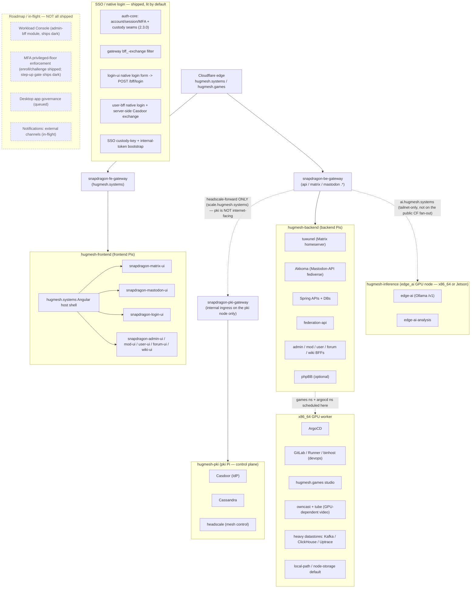
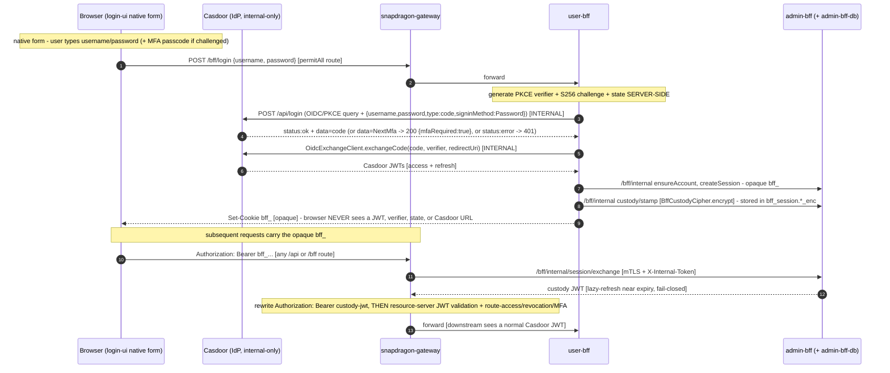

# HugMesh cluster architecture

Everything connects **behind `hugmesh.systems`** through per-namespace
Spring Cloud Gateways that validate a single internal Casdoor OAuth2 JWT.
Cloudflare maps the public `hugmesh.systems` / `hugmesh.games` names onto
those gateways (configured later, out of scope here).

## Nodes & images

| Image | Build | Arch | Role in the cluster |
|---|---|---|---|
| `pki` | `build-rpi5-stage4.sh --role pki` | aarch64 (RPi 5) | **Kubernetes control plane** + identity: headscale (mesh control), Casdoor, Cassandra, `snapdragon-pki-gateway` |
| `backend` | `build-rpi5-stage4.sh --role backend` | aarch64 (RPi 5) | tuwunel (Matrix), Akkoma (fediverse), Spring APIs, databases, `snapdragon-be-gateway` |
| `frontend` | `build-rpi5-stage4.sh --role frontend` | aarch64 (RPi 5) | `hugmesh.systems` Angular host federating `snapdragon-matrix-ui` + `snapdragon-mastodon-ui` + `snapdragon-wiki-ui` + login/admin/mod/user/forum remotes, `snapdragon-fe-gateway` |
| `host` | `build-x86-host-stage4.sh` | x86_64 (desktop/server) | GPU worker: ArgoCD, GitLab/Runner/binhost (devops), `hugmesh.games`, owncast + tube (GPU-dependent video), heavy datastores (Kafka/ClickHouse/Uptrace), local-path/node-storage default (Mesa/Vulkan via `/dev/dri`) |
| `edge_ai` | `build-x86-host-stage4.sh --role edge_ai` (x86_64) **/** `build-jetson-stage4.sh --role edge_ai` (Jetson Orin Nano, arm64 crossdev — the x86 builder is amd64-only and cannot produce a Jetson image) | x86_64 / Jetson Orin Nano (arm64) | GPU **inference** node: Ollama serving an OpenAI-compatible model API (`/v1`) to the mesh over k8s (ClusterIP) + tailnet (`ai.<domain>` gateway route); NVIDIA proprietary + CUDA + `nvidia-device-plugin` (which also makes the GPU schedulable for owncast/coturn/tube voice+video). Model library is the `edge-ai-models` ConfigMap. See [EDGE-AI.md](EDGE-AI.md) |

All nodes are hardened Gentoo, join one Kubernetes cluster, sit on one headscale
mesh, and are provisioned at first boot from a USB **KEYS** stick (see
[`keys-template/`](../keys-template/README.md)). The pki Pi is the kubeadm
control plane; backend/frontend Pis and the x86_64 host join it as workers and
are labelled (`snapdragon.systems/role`, `…/compute=gpu`) so workloads land on
the right hardware.

> The **superadmin Service Catalog** surface (tailnet-only `hugmesh-superadmin-gateway`
> + Kaniko build namespace) is now ✅ shipped on `main` but is reachable **only**
> over the headscale tailnet via the internal ingress on the pki node — it is
> deliberately off every public-ingress gateway, so it is not drawn on the public
> fan-out above. See [§ Superadmin & multi-tenancy](#superadmin-multi-tenancy-and-the-role-cascade).

## The gateway pattern

`snapdragon-gateway` (Spring Cloud Gateway) is deployed once per namespace from
[one Helm chart](../specs/cluster/charts/hugmesh-gateway), differentiated by
`SPRING_APPLICATION_NAME`. Modelled on the org's `snapdragon-gateway` /
`snapdragon-id-gateway`:

- **OAuth2 resource server** against Casdoor's JWKS — the same JWT validates at
  every gateway and API.
- **`ExternalAuthHeaderFilter`** appends `External-Authorization` /
  `External-Auth-Provider` / `External-Auth-Id` so downstreams see the outside
  identity without re-decoding tokens.
- **Public paths** (`/api/auth`, `/api/login`, `/api/registration`) allow
  Google-federated sign-up; everything else is authenticated. **Casdoor exposes
  no browser-facing login UI** — the browser hits the platform's own native form
  and `/bff/login`; Casdoor is reachable only in-cluster.
- Routes per gateway are rendered into an `application-routes.yml` ConfigMap and
  loaded via `SPRING_CONFIG_ADDITIONAL_LOCATION`.

## Identity & login

Casdoor (`id.hugmesh.systems`) is the single IdP, reached **only from inside
the cluster** (there is no public ingress to Casdoor; the browser never sees it):

- **Admin-created accounts** sign in through the platform's **native login form**
  (`login-ui`), which POSTs credentials to `user-bff` `POST /bff/login`; user-bff
  drives Casdoor over the internal network.
- **Google federation** handles public registration/sign-up.
- **tuwunel** (Matrix homeserver, OIDC) and **Akkoma** (Mastodon-API-compatible
  fediverse, OIDC) both SSO against Casdoor, so the `hugmesh.systems` front
  page can show **Matrix / Mastodon links to logged-in users** and hand each
  module a service access token — the
  [`snapdragon-matrix-ui`](https://github.com/Snapdragon-Systems/snapdragon-matrix-ui)
  and [`snapdragon-mastodon-ui`](https://github.com/Snapdragon-Systems/snapdragon-mastodon-ui)
  Angular micro-frontends never render their own login forms. The public
  hostnames stay `matrix.<domain>` / `mastodon.<domain>` for API compatibility,
  but the backing servers are tuwunel / Akkoma (never Synapse / Mastodon).

## Authentication / SSO (BFF JWT custody)

> **State convention:** ✅ shipped = merged to `main` · 🚧 in-flight = code on an
> open branch/PR, not yet merged · 🔭 planned = design-complete, no code. The whole
> ensemble **ships dark** behind flags that default off/blank, so a default
> deployment is byte-identical to today.

**The mandate:** SSO login is a **native, first-party form** — the browser POSTs
username/password (and, when challenged, an MFA passcode) to `user-bff`
`POST /bff/login` and gets back **only** an opaque `bff_` session cookie. Casdoor
and every OAuth/OIDC token stay **internal**: user-bff generates PKCE + state
server-side, POSTs the credentials to the **internal** Casdoor `/api/login`,
exchanges the returned code, and holds/refreshes the JWT under custody. The
browser never receives a JWT, the `code_verifier`, the `state`, or any Casdoor
URL; the gateway swaps `bff_` → an internal custody JWT just before
resource-server validation; the user never sees their own JWT. This keeps the
r2dbc/Casdoor management stack off the gateway's classpath and puts login in the
BFF tier — and, because there is no front-channel redirect, **Casdoor needs no
public ingress at all** (front the platform front door with Cloudflare and Casdoor
stays dark to the internet).

**Component ownership** (post auth-relocation):

- **`hugmesh-auth-core`** (shared jar `systems.hugmesh:hugmesh-auth-core`) —
  the stateful auth stack: `AccountStore`/`BffSession` (account + session + MFA),
  `OidcExchangeClient` (code→token + refresh), `BffCustodyCipher` (AES-256-GCM
  encrypt-at-rest for the held JWT), `SessionCookieService` (the opaque `bff_`
  cookie), `InternalTokenWebFilter` (mTLS + `X-Internal-Token` guard for
  `/bff/internal/**`). Consumed by **admin-bff + user-bff only** — never the gateway.
- **`snapdragon-admin-bff-api`** — owns account/session **data** (admin-bff-db) +
  the in-cluster `/bff/internal` account/session API + the custody/stamp + the
  session/exchange endpoints.
- **`snapdragon-user-bff-api`** — owns the native login **endpoint** `POST /bff/login`
  (permitAll at the BFF): server-side PKCE + state, the internal Casdoor `/api/login`
  POST, the MFA challenge handshake, and the `OidcExchangeClient` code exchange; plus
  the rest of the login surface (`/bff/register`, `/bff/session`, …). Reads/writes
  account + session data over admin-bff `/bff/internal` (never touches admin-bff-db —
  the two BFF databases are mutually denied at the NetworkPolicy layer).
- **`snapdragon-gateway`** — the `BffJwtExchangeWebFilter` that swaps `bff_` →
  custody JWT (pre-security, fail-closed, dark) + the permitAll `/bff/login`
  route-access seed. **No front-door route exposes Casdoor** (`/login/oauth/authorize`
  / the Casdoor UI are never proxied to the browser).
- **`snapdragon-login-ui`** — the first-party **native username/password form** that
  POSTs to `/bff/login` and renders the MFA step-up when challenged; it never
  redirects the browser to Casdoor and holds no Casdoor URL.
- **`hugmesh-generator`** (this repo) — the `app-user-bff` Casdoor confidential
  client (authorization_code grant + internal redirect-uri) + the permitAll
  `/bff/login` route-access seed (#156).

**Invariants** (the security contract — must hold in every deployment):

- The browser holds **only** the opaque `bff_` — the Casdoor JWT (and the
  `code_verifier`, the `state`, and any Casdoor URL) is never sent to or stored in
  the client. The session token appears **only** in the `Set-Cookie` header, never
  in a response body.
- Casdoor is reachable **only internally** (user-bff / be-gateway → `casdoor:8000`);
  no gateway route proxies `/login/oauth/authorize` or the Casdoor UI to the browser,
  and prod gives Casdoor no public ingress.
- The custody JWT is **encrypted at rest** (AES-256-GCM) in `bff_session`
  (`access_token_enc` / `refresh_token_enc`).
- The gateway swap is **pre-security** and **fail-closed**: any exchange error ⇒
  `401`, and the raw `bff_` is **never** forwarded downstream.
- The `/bff/internal/**` surface is reachable only over mTLS + `X-Internal-Token`,
  and the two BFF databases (admin-bff-db / user-bff-db) are mutually denied at the
  NetworkPolicy layer.

**Safety-flag posture.** Each piece above is individually gateable off
(`app.bff.oidc.enabled` on user-bff/auth-core · `app.bff.custody-key` on
`BffCustodyCipher` · `app.session.cookie.enabled` for the `bff_` cookie ·
`hugmesh.gateway.bff-exchange.enabled` for the gateway swap ·
`__SNAP_OIDC_ENABLED__` on login-ui), but **none of them ship dark on `main`**:
`specs/cluster/manifests/{user,admin,mod}-bff-api/deployment.yaml` bake
`APP_BFF_OIDC_ENABLED` / `APP_SESSION_COOKIE_ENABLED` / `APP_BFF_EXCHANGE_ENABLED`
`"true"` by default, and `social-ui/deployment.yaml` bakes `SNAP_OIDC_ENABLED`
`"true"`. Only the **secret values** behind two of them — the Casdoor client
secret and the AES custody key — are `optional: true` ESO-Secret refs, so a
fresh cluster without Vault/ESO populated boots with the flags lit but the
ciphers inert until those Secrets land.

### Progress (as of 2026-06-25)

**✅ shipped (merged to `main`):**

- **auth-core extracted + published (now `2.3.0`)** — shared account/session/MFA/Casdoor
  stack + the custody seams (`OidcExchangeClient`, `BffCustodyCipher`,
  `SessionCookieService`, `InternalTokenWebFilter`). The `2.1.0` BFF-JWT-custody
  columns, the `2.2.0` per-account session-listing seam and the `2.3.0`
  `gen_random_uuid()` mint change have all since shipped; admin-bff + user-bff
  both consume `2.3.0`.
- **admin-bff adopted auth-core** (PR #111) — behavior-preserving, 1517 tests green.
- **admin-bff `/bff/internal` account/session API** (PR #113) —
  ensure / get / complete / allowlist / sessions / namespaces, guarded by
  `InternalTokenWebFilter`; ships inert.
- (prior) gateway live + raw-API security proven + the SCG-5 route-namespace bug fixed.
- **gateway BFF-session filter (PR-2/5 / #171 merged)** — `BffJwtExchangeWebFilter`
  (`bff_` → custody-JWT, pre-security, fail-closed, `hugmesh.gateway.bff-exchange.enabled`).
- **user-bff OIDC enable (PR-2/5 / #171 merged)** — user-bff OIDC login relocation +
  admin-bff internal client (`app.bff.oidc.enabled`).
- **SSO custody-key + internal-token bootstrap (PR-3/5 / #172 merged)** — custody-key
  seeding + internal-token bootstrap for the BFF exchange path.
- **login-ui native login form shipped (#255/#256 merged)** — the native
  username/password form → `POST /bff/login` is now the platform's **only** login
  surface: the dead `/bff/auth/callback` OAuth-redirect route + its route-access
  seed were retired (#255 — "native `/bff/login` replaced it"), and e2e coverage
  (#256, `tests/e2e/specs/27-native-login.spec.ts`) drives the real form and
  asserts the old social-login testids are **absent** and no navigation to a
  Casdoor origin occurs.

> The `auth-core` `2.1.0` BFF-JWT-custody columns
> (`access_token_enc` / `refresh_token_enc` / `access_token_expires_at` /
> `custody_updated_at`) + `stampCustody` / `clearCustody` / `sessionRow` that this
> snapshot tracked as in-flight have since **shipped** (current published `2.3.0`).

**🚧 in-flight:** none currently open — login-ui PR-4 (native form, above) has
since shipped.

**🔭 planned / next:**

- **admin-bff custody tail** — Liquibase band-180 (`bff_session` custody columns) +
  `/bff/internal/sessions/{token}/custody/stamp` + `/bff/internal/session/exchange`;
  bumps the auth-core dep in lockstep (the auth-core custody seam has since shipped
  in `2.3.0`).
- **generator #156** (✅ now merged) — `app-user-bff` Casdoor confidential client
  (authorization_code grant + internal redirect-uri) + permitAll `/bff/login` route
  seed; the user-bff native-login enable + gateway BFF-session filter (#171) and the
  SSO-secret bootstrap seeding (#172) followed on `main`.
- a cross-repo **NetworkPolicy egress peer** user-bff → admin-bff internal `:8080`
  (manifests/generator).
- **SSO end-to-end live e2e** — kind + Playwright, proving the browser holds only `bff_`.

## GitOps

The pki control-plane installs ArgoCD (pinned to the x86_64 worker) and a root
**app-of-apps** pointing at [`specs/cluster`](../specs/cluster). ArgoCD then
syncs Casdoor, Cassandra, the three public gateways (behind an ingress-nginx
facade) plus the tailnet-only superadmin gateway, Akkoma + tuwunel, Forgejo
(in-cluster git), the Spring APIs, the frontend host, the matrix-ui / mastodon-ui
remotes (the `social-ui` ArgoCD grouping), and hugmesh.games. See
[`specs/cluster/README.md`](../specs/cluster/README.md).

> **GitOps source migration — ⏳ PARTIAL.** Today the root app-of-apps syncs from
> the **GitHub** `hugmesh-generator` repo. The move to an **in-cluster Forgejo**
> source-of-truth is scaffolded — the Forgejo deploy (`apps/09-forgejo.yaml`), the
> service-catalog `scmProvider` ApplicationSet (`apps/13-service-catalog.yaml`,
> already configured to scan the in-cluster Forgejo) and the deploy contract
> (`catalog/snapdragon-deploy.example.yaml`) all exist — but the source flip is
> **live-gated** (needs a booted Forgejo + admin + OIDC + the org mirror +
> `forgejo-scm-token`). **9 service repos have adopted the descriptor + a
> `deploy/` kustomize tree** — 6 as `snapdragon-deploy.yaml`, 3 as
> `hugmesh-deploy.yaml` after the rebrand, all ships-dark until the flip. The
> generators filter on **both** names; the live adoption state is registered in
> [`catalog/adopters.yaml`](../specs/cluster/catalog/adopters.yaml) and enforced by
> `scripts/validate-catalog-discovery.sh`. The org has **38** `hugmesh-*` repos,
> **32** of which produce a container image, so **23 have not adopted yet**
> (prep-able now, no cluster needed). See [`DEVOPS.md`](DEVOPS.md).

### Autoscaling

CPU-based **HPA** is wired on many workloads — `frontend`, `social-ui`,
`remote-fragment`, `mod-bff-api`, `admin-bff-api`, `user-bff-api`, `forum-bff-api`,
`user-ui`, `mod-ui`, `forum-ui`, `api-docs` (`manifests/<svc>/hpa.yaml`) — backed
by **metrics-server** (`apps/01-metrics-server.yaml`). **KEDA** is also present
(`apps/01b-keda.yaml`) for event/queue-driven scaling. ⏳ **Remaining:**
latency/memory-based scaling beyond CPU.

## Secrets (Vault + USB)

Cluster secrets are generated once by
[`scripts/gen-cluster-secrets.sh`](../scripts/gen-cluster-secrets.sh) and pushed
to **HashiCorp Vault** (KV v2, mount `secret/`, base path `hugmesh/` — the
base segment tracks the brand slug). The **External Secrets Operator** then
materializes the k8s Secrets the workloads already consume — `casdoor-google`
(`hugmesh-pki`), `clickhouse-auth` (`hugmesh-backend` + `observability`)
and `uptrace-auth` (`observability`) — via a ClusterSecretStore
**`hugmesh-vault`** (provider `vault`, token auth from the `vault-token`
Secret in `external-secrets`), one ExternalSecret per Secret, refreshed hourly.
Workload `secretKeyRef`s are unchanged.

The same materialized secrets are also written to the KEYS stick at
`vault/secrets.json` (plus `vault/token` for online sync), so `keys-provision`
can create them offline — **Vault first, USB fallback** — when Vault is
unreachable.

## Mesh, storage & backups

- **Mesh:** headscale on the pki node; every node runs the tailscale client and
  joins via a preauth key from its KEYS stick.
- **Storage:** `storage.devices[]` in the KEYS manifest mounts attached M.2/NVMe
  or USB disks and can relocate `containerd`/`kubelet` data onto them.
- **Backups:** `backup.*` schedules etcd + PostgreSQL backups to attached
  storage and/or an NFS/CIFS network share (`/usr/local/sbin/hugmesh-backup`).

## Superadmin, multi-tenancy and the role cascade

The platform is **multi-tenant / multi-brand**: one fleet can host several
domains, and a least-privilege role cascade (**superadmin → admin → mod → user**,
domain-scoped, enforced at the gateway) governs every surface.

- **Multi-tenancy (✅ shipped):** per-domain CA loop (`brands/domains.conf`),
  per-domain namespace + mTLS isolation as the authoritative cross-domain
  boundary; one admin-bff ↔ one Casdoor org ↔ one homeserver per brand.
- **Superadmin (✅ shipped):** a real code-enforced role owning device-licenses and
  domain CRUD. Its Service Catalog console + `service-catalog-ui` remote are served by the
  tailnet-only `hugmesh-superadmin-gateway` (`apps/22-gateway-superadmin.yaml`)
  on the pki node's internal ingress — off every public gateway.
- **Superadmin Service Catalog (✅ shipped on `main`):** the data layer (admin-bff
  service-curation / app-profile / service-deployment) **and** the infra legs —
  the tailnet superadmin-gateway plus the Kaniko in-cluster build namespace
  (`apps/54-service-catalog-builder.yaml`, ships dark until a build lands) merged via
  PR #110. The per-build Kaniko Job is a template the admin-bff `AddService` task
  instantiates; ArgoCD never applies it directly.
- **Device-license + node-storage registries (✅ shipped):** see
  [`DEVICE-REGISTRY-KEY-ROTATION.md`](DEVICE-REGISTRY-KEY-ROTATION.md) and
  [`NODE-STORAGE.md`](NODE-STORAGE.md). Layer-B per-node sshd off the signed
  export is shipped; the Layer-A headscale ACL push is 🔭 deferred.
- **Optional-services framework (✅ build-time, 🚧 live cut-over):** akkoma /
  tuwunel / phpBB / games add/remove via the `apps/13a` ApplicationSet; the UI
  greys when a service is absent, and games defaults to `games.<domain>`. Today
  the build-time prune ships and the hardcoded `30-*/50-*` Applications still own
  the workloads — the live ApplicationSet cut-over is pending. See
  [`OPTIONAL-SERVICES.md`](OPTIONAL-SERVICES.md).
- **Egress-VPN, games App-Store control plane, owncast, tube, notifications
  in-app MVP (✅ shipped):** see [`EGRESS-VPN.md`](EGRESS-VPN.md),
  [`GAMES-APPSTORE.md`](GAMES-APPSTORE.md), and the cluster apps `29a`, `52`, `53`,
  `13c`.
- **Pen-test CI (✅ shipped):** continuous OWASP (ZAP DAST + Dependency-Check SCA +
  nuclei + k6) as a GitLab CI-pipeline stage, not a deployed CronJob. See
  [`PENTEST-SCHEDULES.md`](PENTEST-SCHEDULES.md).

### Roadmap (🔭 planned / 🚧 in-flight)

These are **not shipped as user-facing features** on `main`; the in-cluster
backstops noted below may already be present but inert.

- **🚧 Workload Console** — podman/OpenShift-like pod-management + live-log + exec
  federated admin-ui module (admin-bff 110-band). The least-privilege RBAC
  backstop is on `main` (`apps/14-workload-console-rbac.yaml`) but **ships dark**
  (`app.workload-console.k8s.enabled=false`); superadmin gets cross-cluster
  manage+exec, admins are default-blind until superadmin-granted read-only on
  their own domain.
- **🔭 Casdoor MFA** — WebAuthn + TOTP + recovery; per-role defaults
  (superadmin/admin required, mod relaxable, user optional); enforced via
  `amr/acr → MFA_SATISFIED` + `gateway_route_access.mfa_required` (fail-closed) +
  step-up for sudo / SSH-via-UI / remote-install. Design done (admin-bff
  Liquibase 150-band); see [`ROUTE-ACCESS.md`](ROUTE-ACCESS.md).
- **🔭 Desktop app governance** — per-license SSO-enforced sudo + admin-curated
  Plasma Discover store + user install-requests + admin remote-install; extends
  [`CLIENT-IMAGES.md`](CLIENT-IMAGES.md).
- **🚧 MDM phones (GrapheneOS on Pixel)** — the fourth onboarding form: `scripts/phone-wizard.sh` flashes signature-verified GrapheneOS, enrolls the handset into the orchestration superdomain (headscale tailnet, ADR-14 register-and-approve), escrows a separately-encrypted enterprise profile, and emits a `phone-ingest/v2` device-registry record; see [`MDM.md`](MDM.md).
- **🚧 Notifications external channels** — Matrix DM + Akkoma feed + phpBB + email
  adapters on top of the shipped in-app MVP; mod-bff `notify_channels` directive.
- **✅ Generator supply-chain hardening** — stage3 GPG/sha + headscale /
  tailscale binary checksum verification, fail-closed in all four builders via
  `scripts/_download-lib.sh`, + de-defaulted baked creds (random one-time
  first-boot fallback). See [`CRYPTO-AUDIT.md`](CRYPTO-AUDIT.md).

## Related repositories

| Repo | Role |
|---|---|
| `Snapdragon-Systems/hugmesh-generator` | This repo — image builders, provisioning, GitOps payload |
| `Snapdragon-Systems/snapdragon-gateway` | Shared Spring Cloud Gateway code/image |
| `Snapdragon-Systems/snapdragon-pki-gateway` | PKI/identity gateway (Casdoor OAuth2, Postgres routes) — renamed from `snapdragon-id-gateway` |
| `Snapdragon-Systems/snapdragon-be-gateway` | Backend gateway (per-node, reuses the shared gateway image) |
| `Snapdragon-Systems/snapdragon-fe-gateway` | Frontend gateway (per-node, reuses the shared gateway image) |
| `Snapdragon-Systems/snapdragon-actions` | Spring APIs |
| `Snapdragon-Systems/snapdragon-admin-bff-api` | Spring admin BFF (allowlist, namespace access, usage, token broker) |
| `Snapdragon-Systems/snapdragon-mod-bff-api` | Spring moderator BFF |
| `Snapdragon-Systems/snapdragon-user-bff-api` | Spring user BFF |
| `Snapdragon-Systems/snapdragon-forum-bff-api` | Spring forum BFF (phpBB-facing) |
| `Snapdragon-Systems/snapdragon-federation-api` | Public-profile / vanity-subdomain + federation resolver |
| `Snapdragon-Systems/snapdragon.systems` | Angular host front page (federates the remotes) |
| `Snapdragon-Systems/snapdragon-matrix-ui` | Matrix chat + WebRTC video micro-frontend (renamed from `snapdragon-social-ui`) |
| `Snapdragon-Systems/snapdragon-mastodon-ui` | Mastodon micro-frontend |
| `Snapdragon-Systems/snapdragon-login-ui` | Login/registration micro-frontend |
| `Snapdragon-Systems/snapdragon-admin-ui` | Admin console micro-frontend (role-gated) |
| `Snapdragon-Systems/snapdragon-mod-ui` | Moderator console micro-frontend |
| `Snapdragon-Systems/snapdragon-user-ui` | User console micro-frontend |
| `Snapdragon-Systems/snapdragon-forum-ui` | Forum micro-frontend |
| `Snapdragon-Systems/snapdragon-wiki-bff-api` | Spring wiki BFF (wiki pages, attachments, audit log; /bff/wiki/**) |
| `Snapdragon-Systems/snapdragon-wiki-ui` | Wiki Angular micro-frontend (federated into snapdragon.systems host) |
| `Snapdragon-Systems/snapdragon-remote-fragment` | Shared federated-remote fragment scaffolding |
| `Snapdragon-Systems/snapdragon-superadmin-service-catalog-ui` | Superadmin Service Catalog console (genesis / 🚧 in-flight) |
| `owncast` / LocalTube (`tube`) | GPU-dependent video services (per-domain enable, federated per-user remotes) |
| `Snapdragon-Systems/snapdragon.games` | Game studio and portal (runs on the x86_64 GPU worker) |
| `Snapdragon-Systems/sdn` | headscale / SDN config |
