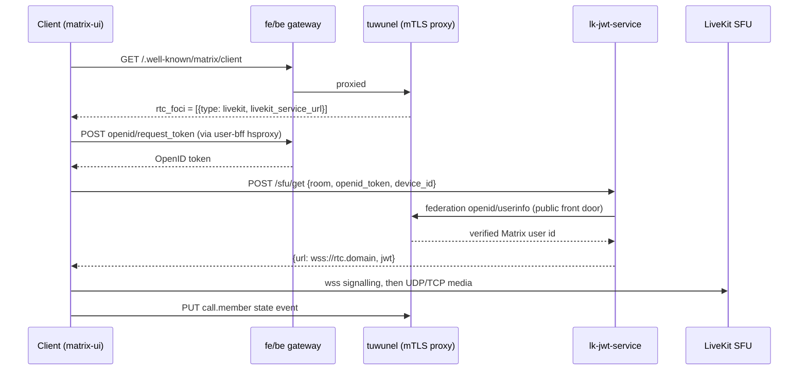

# Group-call SFU (MatrixRTC + LiveKit) — design

> **Status: DESIGN ONLY. Nothing in this repo deploys an SFU.** The technology
> was chosen on 2026-09-23 (hugmesh-admin-bff-api#98, decisions 102a and 102b).
> The **client half** has shipped dark in `hugmesh-matrix-ui`. The **server
> half** (this repo) is not built. This page is the plan for it. Measured
> 2026-10-15 against `hugmesh-generator` origin/main `b8505112`,
> `hugmesh-matrix-ui` origin/main `b4c13dc` (its `rtc/` directory is unchanged
> since `26408d5`), tuwunel main `f473d9a` and tag
> `v1.7.0` (the tag the mesh pins). Where the two tuwunel refs differ, this
> page says which one a statement is about.

## 1. Decision (already made; not reopened here)

Recorded on hugmesh-admin-bff-api#98:

- **102a = A.** Calls stay on the Matrix homeserver and rooms. A LiveKit media
  server does the forwarding (the Element Call model). The client moves from
  per-pair `m.call.*` signalling to MatrixRTC. tuwunel advertises the media
  server.
- **102b = A.** Build it for launch: deployable from the generator specs, off by
  default like coturn, and a three-party call proven off the local network.

Alternatives, considered for the record and not chosen:

| Option | Why not |
|---|---|
| Keep the full-mesh peer-to-peer calls only | Each client uploads N-1 copies of its stream. matrix-ui caps a chat3d room at 2..16 (default 8) for that reason. This is the status quo that #98 exists to leave. |
| Jitsi or another general-purpose conferencing stack | Not Matrix-native: a second identity and room model beside the homeserver. 102a chose against it. |
| mediasoup, Janus, or a hand-rolled SFU | No MatrixRTC client ecosystem. We would own the signalling protocol and the JWT story. |
| Element Call SPA as the only client | Compatible with this design (it speaks the same foci), but it is a separate web app. It can be added later behind the same server half. It is not needed for the chat3d use case. |

## 2. What exists today (measured)

**Client half, `hugmesh-matrix-ui`, merged and dark.** Commits `f8b35f9`,
`40863b3`, `26408d5`; PR #18, merge `701b9be`. Files:
`projects/matrix/src/app/rtc/matrix-rtc.ts` and `matrix-rtc.service.ts`. It is
behind the global `__HUG_MATRIX_RTC__` (default off; with it off nothing makes a
request). What it calls, in order:

1. `GET /.well-known/matrix/client` (same origin; the fe-gateway
   `matrix-wellknown` route serves tuwunel's own document) and reads
   `org.matrix.msc4143.rtc_foci`. Only `type: livekit` entries with an `https:`
   `livekit_service_url` survive.
2. `POST /_matrix/client/v3/user/{userId}/openid/request_token` through the
   user-bff hsproxy.
3. `POST {livekit_service_url}/sfu/get` with `{room, openid_token, device_id}`,
   cookies omitted, answer `{url, jwt}`. The `url` must be `wss:`.
4. Lazy-loaded `livekit-client` connects to that `url`.
5. After a successful connect it PUTs the `org.matrix.msc3401.call.member`
   state event (key `_{userId}_{deviceId}_m.call`) and clears it with `{}` on
   leave.

Where it is used: only the chat3d voice mesh, and only when the roster is above
the room's peer-to-peer cap and a focus is advertised. The 1:1 call screen is
still `m.call.*`. With no focus the cap stands.

**Server half, this repo: absent.** A scan for `livekit`, `lk-jwt`,
`rtc_foci` and `matrixrtc` over `specs/`, `scripts/` and `tests/` (excluding the
vendored UI bundle under `tests/stack/.uidist`) finds nothing. No manifest,
no registry row, no secret, no firewall rule. `tests/scripts/test-group-call-sfu-doc-honesty.sh`
runs that scan and fails when it stops being true, so landing stage 1 forces this
page and its status banner to be updated in the same change.

**One thing already true on the homeserver.** The pinned tuwunel
`ghcr.io/matrix-construct/tuwunel:v1.7.0` already carries the discovery side:
the tag's `tuwunel-example.toml` documents `[global.well_known] livekit_url`
and `rtc_transports`, and `src/api/client/rtc.rs` at that tag serves
`GET /_matrix/client/unstable/org.matrix.msc4143/rtc/transports` from them
(`src/api/router.rs:249` registers the route), and `src/api/client/well_known.rs`
builds `rtc_foci` from the same source, so the client well-known carries the
focus. The pinned tag does **not** list `org.matrix.msc4143` in
`GET /_matrix/client/versions` (`versions.rs` at `v1.7.0` has no `msc4143`
entry; the entry was added on main, `versions.rs:113`). That does not matter
here, because the matrix-ui client reads the well-known, not `/versions`, but
a person who probes `/versions` on the pinned image will not see it. No tuwunel
bump is needed for discovery.

## 3. What the mesh needs

Four pieces, all new:

| Piece | What | Notes |
|---|---|---|
| LiveKit server | The SFU. Apache-2.0. `livekit/livekit-server`, multi-arch (amd64 and arm64 verified on the registry at v1.13.10). | The media plane. UDP and a TCP fallback. |
| lk-jwt-service | Trades a Matrix OpenID token for a LiveKit join JWT. `element-hq/lk-jwt-service`, **AGPL-3.0** (also sold under a commercial licence). Its release workflow builds amd64 and arm64. | Now written in Rust. The control plane. Plain HTTPS. |
| Shared key and secret | One LiveKit API key and secret, read by both of the above. | Vault path plus ESO, section 6. |
| Discovery | tuwunel `livekit_url` so the client well-known carries `rtc_foci`. | One line, section 5. |

### 3.1 Data flow

### 3.2 Hostnames

One new public name, `rtc.<domain>` (the tuwunel guide uses `matrix-rtc.`; pick
one and keep it). It carries two things behind a path split:

- `/sfu/get`, `/get_token`, `/healthz` to lk-jwt-service;
- everything else, including the WebSocket upgrade, to LiveKit's signalling port.

Signalling is HTTPS and WebSocket, so it can ride the normal ingress or the
Cloudflare tunnel. **Media cannot.** It is UDP (and a TCP fallback) between the
client and the node. Unlike coturn, the media address is not a DNS name: the SFU
advertises ICE candidates built from its configured node IP. So the DNS record
for `rtc.<domain>` is for signalling only, and the public IP the SFU advertises
is an operator fact, exactly like coturn's `external-ip` (COTURN.md section 5).

Two consequences for this repo's name handling:

- `specs/cluster/reserved-prefixes.yaml` must gain the label. A user who registers
  `rtc` would otherwise shadow `rtc.<domain>`.
- Adjacent defect, found while measuring and not fixed here: the same file has no
  `turn` label, although `hugmesh-go-live` already emits `turn.<domain>` when the
  coturn marker is present. `grep -w` for `turn`, `rtc`, `coturn` and `livekit` in
  that file returns nothing. Worth its own issue.

## 4. Constraints from what we already run

### 4.1 tuwunel

Measured from tuwunel's own compliance table (`docs/development/compliance/msc.md`)
at both refs, 2026-10-10 for main `f473d9a` and 2026-10-14 for the pinned tag
`v1.7.0`. The status marks differ between the refs (the tag marks MSC4143 supported and
MSC4195 unsupported, main marks both partial), but neither implements
`get_token`, delayed events, `is_joined` or a proxy prefix. The tag is what
runs, so the tag column decides.

| MSC | pinned tag `v1.7.0` | main `f473d9a` | Effect here |
|---|---|---|---|
| MSC4143 (transport discovery) | ✅ ◐ "GET rtc/transports routed; only HS-side requirement of the MSC" | 🟨 ◐ partial, "GET rtc/transports served; slots and sticky membership are client and MSC4354" | the transports route is served, which is the one thing we need; the rest of MSC4143 is client side |
| MSC4195 (LiveKit backend) | ❌ ◐ "livekit advertised in /rtc/transports; JWT and delayed events out of scope" | 🟨 partial, "MSC4143 transport advertised; no get_token, derivation, salt or delayed leave" | lk-jwt-service must be a separate service |
| MSC4140 (delayed events) | ❌ "delayed events endpoints not implemented despite Ruma types" | ❌ "No delayed_event routes, no m.delayed_events capability, no delay_id anywhere" | no server-side cleanup of a crashed client's membership |
| MSC4502 (`is_joined`) and MSC4512 (proxy prefix) | not in the tag's table; `git grep -i 'msc4502\|msc4512\|proxy_prefix'` over `src/` at the tag finds nothing | ❌ "no is_joined route, no scope token, no AS registration scopes" and "no proxy_prefix/proxy_url in AS registration" | lk-jwt-service **cannot run as an application service** against tuwunel |

The last row decides the security posture (section 7). tuwunel has no
application-service route to a membership check, so lk-jwt-service runs in its
**standalone mode**, which its README marks deprecated.

Config nesting: tuwunel parses env with a double underscore, so the env form of
`well_known.livekit_url` is `TUWUNEL_WELL_KNOWN__LIVEKIT_URL`. A single
underscore is silently discarded (the 2026-08-14 `well_known` incident,
`tests/stack/compose.real.yaml`). The startup log says so with `Config
parameter ... is unknown`. Any stage that sets it must grep for that.

### 4.2 Homeserver isolation

`manifests/networkpolicy/homeserver-isolation.yaml` makes tuwunel reachable only
through its mTLS proxy and only from named callers. lk-jwt-service is not one of
them and should not become one. It must verify the OpenID token over the **public
federation endpoint** (`/_matrix/federation/v1/openid/userinfo`, discovered via
`/.well-known/matrix/server`), which the be-gateway already routes. Two open
questions that only a live cluster can answer:

- Can the lk-jwt-service pod resolve and reach `matrix.<domain>:443` from inside
  the cluster (hairpin through the ingress, or a CoreDNS rewrite)?
- Does it trust the certificate? A cluster-CA or per-domain-CA front door needs
  the CA bundle mounted into the pod. `LIVEKIT_INSECURE_SKIP_VERIFY_TLS` exists
  and is development-only: do not set it.

### 4.3 coturn

coturn stays the 1:1 and small-mesh relay. Interplay, none of which is solved
here:

- **Ports do not collide today.** coturn: 3478 and 5349 (UDP+TCP) and relay
  49152-49200/UDP. LiveKit: signalling 7880/TCP, ICE-TCP 7881, and UDP media.
  Keep LiveKit's UDP clear of 49152-49200. LiveKit's own sample defaults to
  50000-60000 (10k ports), far wider than the coturn window; prefer either its
  single or short `rtc.udp_port` range (the sample shows `7882-7892`; it applies
  only when `port_range_start` and `_end` are unset) or the tuwunel guide's
  50100-50200. Both host-network pods share one node, so also check the
  kernel's ephemeral range (the coturn firewall script already notes its window
  sits inside it).
- **LiveKit can use coturn.** `rtc.turn_servers` takes a host, port, protocol
  and `secret`; the guide wires it to a coturn `static-auth-secret`. That is the
  REST-secret mode coturn already runs, so it could reuse `coturn-shared-secret`.
  Needed only for clients that cannot reach the SFU's UDP or TCP directly.
- **coturn will refuse some SFU addresses.** `denied-peer-ip` blocks loopback,
  link-local, RFC1918 and `100.64.0.0/10` (the tailnet). If the SFU advertises a
  private or tailnet address, a relayed client cannot reach it through coturn. The
  shipped deny set must not be narrowed to fix this (COTURN.md section 5).
- **LiveKit's built-in TURN is not used.** It duplicates coturn, needs its own
  certificate, and a wide relay range (50300-65535 in the guide). It also only
  serves LiveKit, not ordinary Matrix calls.
- **The SFU is not an egress-VPN workload.** Do not label it `vpn-egress`. Media
  through a WireGuard tunnel adds latency and breaks the advertised address.

### 4.4 Firewall and placement

Same reasoning as COTURN.md section 5: ICE candidates must be reachable 1:1, so
the media pod needs `hostNetwork` on one pinned backend node (NodePort and
kube-proxy cannot claim these ports, and a remapped port is useless because the
peer dials the advertised address:port). The NetworkPolicy does not apply to
host-network pods, so the node firewall is the enforcement point. Mirror
`specs/usr/sbin/hugmesh-coturn-firewall`: a marker file (for example
`/etc/hugmesh/livekit-public`) that is absent by default (closed), firewalld
runtime ports on x86, and an own nftables table as the fail-closed backstop that
is the whole gate on ARM. The signalling and lk-jwt-service pods need no host
network and can stay ordinary ClusterIP behind the ingress.

## 5. tuwunel advertisement

One line in the existing `[global.well_known]` table of
`specs/cluster/manifests/tuwunel/tuwunel.yaml`, which must remain the **last**
table in that file (a following bare key would land in the sub-table). The dark
pattern is the coturn one: leave the toml unset and inject the value through an
`optional: true` env from a ConfigMap that exists only when the service is on, so
a default build is byte-identical.

**This is deliberately not done in this change.** Setting `livekit_url` now would
advertise a focus that does not exist, to every client with the flag on. The
well-known then carries `rtc_foci`, matrix-ui tries it, `POST /sfu/get` fails,
and the room reports a failed join instead of the honest "no media server" note.

## 6. Secrets

A new Vault path, `secret/hugmesh/livekit` (properties `key` and `secret`),
delivered by one `ExternalSecret` in `hugmesh-backend`, mirroring
`external-secrets/coturn-externalsecrets.yaml` (a static, long-lived secret; an
annual `refreshInterval`; `creationPolicy: Owner`). It is read by both the
LiveKit config and lk-jwt-service, so the two cannot drift. The upstream guidance
is a 20-character key and a 64-character secret, generated by the operator or the
bootstrap, never committed. A rotation is a restart of both pods. The SFU's
webhook `api_key` must also be that key if delegated leave is ever enabled.

## 7. Security and the standalone-mode gap

Because section 4.1 forces standalone mode, state the residual risk plainly:

- lk-jwt-service's `/sfu/get`, `/get_token` and `/delegate_delayed_leave` check
  that the OpenID token is real. In standalone mode they do **not** check that the
  user is joined to the room they ask for (its README: the membership check
  applies only as an application service). Any account on an allowed homeserver
  can mint a join JWT for any room id it can name.
- The room id is not a secret that gates anything: other members, federation and
  invites all expose it. So treat the JWT as proof of identity, not of room
  membership.
- **Mitigations we can apply:** set `LIVEKIT_FULL_ACCESS_HOMESERVERS` to exactly
  our `server_name` (never `*`), so foreign homeservers cannot create rooms; set
  `room.auto_create: false` in the LiveKit config (the README says the first
  setting does nothing without the second); cap participants per room with LiveKit
  `max_participants`.
- **What remains:** a local user can sit in another room's SFU session and hear or
  send media. Within one mesh the users are already vetted by the identity
  provider, so the exposure is a trust one, not an anonymous one. It closes when
  tuwunel implements MSC4502 and MSC4512 and lk-jwt-service moves to application
  service mode. Track that as the exit condition and do not document the
  standalone mode as safe.
- **Browser side.** matrix-ui already refuses a non-`https` focus, a non-`wss`
  LiveKit URL, and sends no cookies to the focus origin. The page CSP already
  allows `connect-src https: wss:`, so no CSP change is needed.
- **Rooms.** Most rooms give `state_default: 50` (matrix-ui's own comment in
  `matrix-rtc.service.ts` says so, and `matrix.service.ts` falls back to 50 when
  a room sets none), so an ordinary member cannot publish
  `org.matrix.msc3401.call.member`. Room setup needs an `events` override giving
  that type power level 0. The membership publish is best effort in the client
  (the SFU room works without it), but without the grant other MatrixRTC clients
  will not list the call. Rooms are created from matrix-ui, so the change most likely
  belongs there (not checked in code).
- **Cleanup without delayed events.** With no MSC4140 a crashed tab never clears
  its membership. The client sets a 4-hour expiry
  (`CALL_MEMBERSHIP_EXPIRES_MS`) and reuses device ids (at most 4 per browser) so
  stale keys stay bounded. Plan for stale "in call" entries up to 4 hours. This
  also removes the reason to give lk-jwt-service a webhook or Redis in the first
  stage (`LIVEKIT_SANITY_CHECK_INTERVAL_SECONDS` and delegated leave need
  application-service mode anyway).

## 8. Roles

| Who | What they do |
|---|---|
| Operator | Provisions the Vault key and secret, picks and pins the relay node, sets the public node IP, creates the marker file, flips the two gates. |
| Admin (`ROLE_ADMIN`) | Turns the optional service on or off in the admin console, once it is a registered slug. |
| Room moderator (power level 50) | Owns the per-room power-level change that lets members publish call membership. |
| Member | Joins a call. Needs nothing beyond the grant above. |
| lk-jwt-service | Identity only (standalone mode), no homeserver token, no role. The homeserver allow-list is by server name, not by platform role. |

Gateway access: if `rtc.<domain>` is served from its own ingress, like coturn and
the other non-gateway optional services, no `gateway_route_access` row is needed.
If the be-gateway fronts it instead, add rows deliberately: the open posture of
the Matrix client surface does not carry over, because the JWT endpoint is an
authenticated surface.

## 9. Resource cost

No numbers are invented here: nothing has been measured on this fleet. The
shape, so the operator can size it:

- An SFU receives each publisher once and forwards it to each subscriber. With N
  participants, all publishing audio at `b` and all subscribing to everyone:
  ingress is about `N * b`, egress about `N * (N-1) * b`. Egress is the term that
  grows, and it is the node's uplink that saturates first, not its CPU.
- The peer-to-peer mesh it replaces costs each *client* `(N-1) * b` upload. The
  SFU moves that cost to the server and caps the client at `b`.
- Video, screen share and larger rooms multiply `b` and add transcoding-free but
  nonzero forwarding work. chat3d is audio plus a few-byte data channel (the
  matrix-ui source puts the pose, blendshape and speaking frames at 17, 53 and 2
  bytes), so audio is the dominant stream.
- Both pods are small and single-replica by design. LiveKit scales out across
  nodes only with Redis and a routing config. Not planned here.
- Pi 5 backend nodes are a candidate: the images are multi-arch. Whether a Pi's
  uplink and CPU carry a given room size is not measured.

Rule of thumb for the operator: size the relay node's **uplink** against
`N * (N-1) * b` for the largest room you intend to host, and set LiveKit
`max_participants` and the chat3d `maxParticipants` below that.

## 10. Staged plan

Each stage says what it proves and who runs it. A stage is not done until its
"proves" is observed.

| Stage | Content | Proves | Who |
|---|---|---|---|
| 0. This page | Design, plus correcting the "does not exist in any form" wording that predates the client half | The plan and its constraints are written down | Done in this change |
| 1. Dark server manifests | `livekit` and `lk-jwt-service` Deployments, config ConfigMaps, ExternalSecret, NetworkPolicy, in `hugmesh-backend`; a registry row in `optional-services.yaml`, a 13a element, an `installed-services` key; a runtime-only slug like coturn. The slug-closure guard (`test-optional-service-slug-closure.sh`) names every surface still missing it, including the CRD enum, the seed CR and admin-bff's `OptionalServiceRegistry` (it reads the sibling admin-bff checkout) | Manifests render, the slug closes across all five surfaces, a default build is byte-identical | Code and tests on a workstation. Wiring any new guard into the CI workflows is an operator edit under `.github/`. |
| 2. Discovery switch | The optional `TUWUNEL_WELL_KNOWN__LIVEKIT_URL` env from a ConfigMap that only exists when the slug is on | A throwaway tuwunel at the pinned tag returns `rtc_foci` on `/.well-known/matrix/client` with the slug on, and an unchanged body with it off. Check the startup log for `unknown` | A person, on a throwaway compose project (the operator's live stack is not to be touched) |
| 3. Public reachability overlay | Host-network media pod, the `/etc/hugmesh/livekit-public` marker and firewall script, `rtc` in go-live's hostname set and in `reserved-prefixes.yaml`, the certificate for `rtc.<domain>` | The marker-gated firewall is closed by default and opens and closes within one cron tick; the record plan carries `rtc.<domain>` | Shell tests with fakes on a workstation (the coturn firewall tests are the model). Open ports and DNS: operator. |
| 4. Client enablement | A deploy-time way to set `__HUG_MATRIX_RTC__` (the shipped image has no setter: `docker-entrypoint.d` holds only the theme hook), and the power-level grant in room creation | The flag can be turned on per mesh without a rebuild | `hugmesh-matrix-ui`, a separate lane |
| 5. Live proof (the #98 done-when) | Real LiveKit and lk-jwt-service on a real mesh, a public relay node | A three-party call works off the LAN; a chat3d room of 9 or more gets audible voice on the SFU; a late joiner hears existing members; after dropping to the cap a newcomer gets voice; 1:1 calls still use coturn | A person on a live mesh (label `manual-test`). Not provable on a workstation. |
| 6. Follow-ups | MSC4140 and MSC4502/4512 support in tuwunel, then lk-jwt-service in application-service mode (closes the section 7 gap) and delegated leave; move the 1:1 call screen onto MatrixRTC; an optional Element Call SPA | The standalone-mode risk is retired | Upstream, then a later lane |

#98's own done-when keeps the "not built" markers in the README and
ARCHITECTURE.md until stage 5 is observed. This change keeps them, with accurate
wording.

## 11. Not built, on purpose

- No manifest and no registry row. A `gate: none` registry row would be a
  placeholder the builders must refuse; a live row would ship an untestable
  service. Stage 1 should land them together.
- No `livekit_url`. See section 5.
- No image pins. LiveKit v1.13.10 was current on the registry at the time of
  writing; the lk-jwt-service version was not read. Pin both by digest in stage 1
  and record the date.

## 12. Sources read for this page

- hugmesh-admin-bff-api#98 and its comments (decisions 102a and 102b, slice 1 status).
- `hugmesh-matrix-ui` `projects/matrix/src/app/rtc/*` and its README.
- tuwunel: `docs/calls/matrix_rtc.md`, `tuwunel-example.toml`, `src/api/client/rtc.rs`,
  `src/api/router.rs` and `src/api/client/well_known.rs` (tag `v1.7.0`),
  `src/api/client/versions.rs` (tag `v1.7.0`, where it has no `msc4143` entry,
  and main, where it does), and `docs/development/compliance/msc.md` (tag
  `v1.7.0` and main `f473d9a`).
- element-hq/lk-jwt-service `README.md`, `LICENSE`, `.github/workflows/docker.yaml`.
- livekit `config-sample.yaml`; Docker Hub tags for `livekit/livekit-server`.
- This repo: `docs/COTURN.md`, `docs/XR-CHAT.md`,
  `specs/cluster/manifests/{tuwunel,coturn,coturn-public,networkpolicy}`,
  `specs/usr/sbin/hugmesh-coturn-firewall`, `specs/cluster/optional-services.yaml`,
  `specs/cluster/reserved-prefixes.yaml`.

Not verified: the lk-jwt-service code path that resolves the OpenID issuer (read
from its README, not its source, because the unauthenticated source listing was
rate limited); the LiveKit and lk-jwt-service behaviour behind a Cloudflare
tunnel; any runtime behaviour at all.
